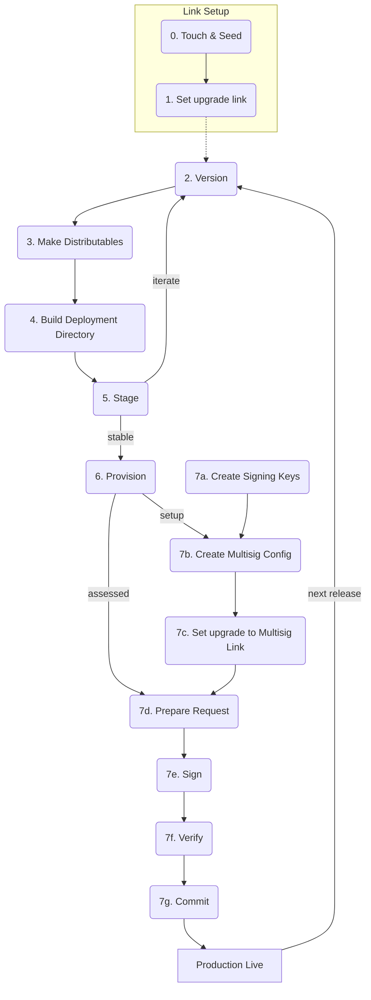

# hello-pear-bare-tui

> Pear Hello World for Standalone Bare Terminal UIs with `pear-runtime` worker

End-to-end boilerplate for embedding [pear-runtime] into the [Bare] worker of a [Bare] terminal UI with peer-to-peer OTA update support.

This is [hello-pear-bare] with a [bare-tui] front end: the same entrypoint, updater resource and worker, but instead of logging to stdout the app renders a full-screen terminal UI.

This boilerplate uses the companion [`hello-pear-worker`][hello-pear-worker] as a reusable cross-platform local backend. Keeping networking, storage and updates in a separate worker lets mobile apps, desktop UIs and standalone Bare applications share the same backend implementation while each parent owns its platform-specific interface.

- Terminal UI with [bare-tui] (The Elm Architecture for Bare, after Bubble Tea)
- Peer-to-Peer deployment with [pear][pear-docs] CLI
- Peer-to-Peer Over-the-Air updates with [`pear-runtime`][pear-runtime] module
- Bare worker process via `PearRuntime.run(...)`
- Cross-platform standalone distributables via [`bare-build`][bare-build]

## Table of Contents

- [Related Repositories](#related-repositories)
- [OS Support](#os-support)
- [Requirements](#requirements)
- [Development](#development)
  - [Install Dependencies](#install-dependencies)
  - [Create an upgrade link](#create-an-upgrade-link)
  - [Start](#start)
- [Architecture](#architecture)
  - [Terminal UI](#terminal-ui)
  - [Updates](#updates)
  - [Workers](#workers)
- [Peer-to-Peer Deployments](#peer-to-peer-deployments)
- [Installing Distributables](#installing-distributables)
- [Scripts](#scripts)
  - [Signing Standalones](#signing-standalones)
- [Project Structure](#project-structure)
- [Troubleshooting](#troubleshooting)

## Related Repositories

Pear has official templates for desktop, terminal, short-lived CLI, and mobile apps. See [Start from a template][from-a-template] to compare them and pick the one that matches what you're shipping.

## OS Support

- **macOS** — arm64, x64
- **Linux** — arm64, x64
- **Windows** — arm64, x64

## Requirements

- `npm` via [Node.js][nodejs]
- [pear][pear-docs] - `npx pear`

## Development

### Install Dependencies

```sh
npm install
```

### Create an upgrade link

The `upgrade` field in `package.json` must hold a valid `pear://` link, even with `--no-updates`. This template ships with a working link so `npm start` runs out of the box. Replace it with your own link before you release, because it decides where your users get updates from. An invalid link makes startup fail with `INVALID_URL`. The terminal UI does not start in that case, so the error prints as plain output.

Create a link with [`pear touch`](https://docs.pears.com/reference/cli.html#pear-touch-flags-channel):

```sh
pear touch
```

Copy the generated `pear://...` link into the `upgrade` field in `package.json`.

### Start

Start app in development mode:

```sh
npm start
```

This opens the terminal UI: a live console with a spinner header, a feed of the app's log lines and the worker's IPC messages, and the available keys. Press <kbd>q</kbd> or <kbd>Ctrl+C</kbd> to quit; the terminal is restored on exit.

| Key                              | Action                    |
| -------------------------------- | ------------------------- |
| <kbd>Enter</kbd>                 | send `ping` to the worker |
| <kbd>q</kbd> / <kbd>Ctrl+C</kbd> | quit                      |

In the feed, `‹` marks a message from the worker, `›` a message sent to it, and indented lines are the app's own log. The hello-pear-bare worker echoes anything it doesn't handle as `unknown-message <text>`, which the UI shows as `‹ worker received: <text>`. The plain-output line `CLI ready. Press Ctrl+C to stop.` is left out, since the footer lists the keys.

Send a custom message to the worker at startup (default `hello from tui`):

```sh
npm start -- --message "hello from dev"
```

By default this repo starts with `--no-updates` in development to avoid local dev binaries being swapped while you iterate.

Enable updates for local flow testing:

```sh
npm start -- --updates
```

## Architecture

```
bin.mjs ── console lines ─┐
   │                      ▼
   │                   tui.js (bare-tui Program) ── renders ──▶ terminal
   │                      ▲
   └── app.js (App) ── events
          │
          └── framed IPC ──▶ workers/main.js (pear-runtime, Hyperswarm, Corestore)
```

`app.js` and `workers/main.js` are identical to [hello-pear-bare]. `bin.mjs` is hello-pear-bare's entrypoint plus an `import TUI from './tui.js'`, a `--message` flag, and three lines that hand its output to the UI:

```js
const tui = TUI.start({ name: appName, upgrade: pkg.upgrade, message: cmd.flags.message })
const console = tui ? tui.console : globalThis.console
tui?.attach(app)
```

Everything else about the terminal UI is in `tui.js`.

### Terminal UI

`tui.js` is a [bare-tui] model, with `init()`, `update(msg)` and `view()`, running in a bare-tui `Program`. The `Program` owns the screen (raw mode, alternate screen, input decoding, resize) and restores the terminal on every exit.

Because the UI owns the screen, nothing may print to stdout while it runs. `TUI.start()` returns a `console` that sends each line `bin.mjs` prints into the feed instead. `attach(app)` connects the UI and the `App`:

- Worker messages (the `App`'s `message` event) show as worker lines.
- The `--message` text is sent to the worker once the `App` is ready, and <kbd>Enter</kbd> sends `ping`, both over the `App`'s IPC pipe.
- Quitting the UI closes the `App`.
- Closing the `App` (on a signal or a failed startup) quits the UI.

The model receives these messages:

| Message                                 | Source                                        |
| --------------------------------------- | --------------------------------------------- |
| `{ type: 'log', level, line }`          | a line `bin.mjs` printed                      |
| `{ type: 'worker', data }`              | a message from the worker                     |
| `{ type: 'key' }`, `{ type: 'resize' }` | terminal input and window size, from bare-tui |

To build your own UI, edit `tui.js`. See the [bare-tui docs][bare-tui] for components (`list`, `table`, `textinput`, `viewport`, `progress`, ...), `style` and layout.

`TUI.start()` returns `null`, and the app runs exactly as hello-pear-bare, in two cases:

- stdin or stdout is not a terminal (piped, redirected, CI);
- the `upgrade` link is invalid, because the worker then aborts the process before the terminal could be restored.

```sh
npm start | cat
```

In that case `--message` is accepted but not sent, as hello-pear-bare has no UI to send it from.

Exit codes are the same as hello-pear-bare: `130` / `129` / `131` / `143` for `SIGINT` / `SIGHUP` / `SIGQUIT` / `SIGTERM`, and `1` if startup fails. In the UI, <kbd>q</kbd> exits with `0` and <kbd>Ctrl+C</kbd> with `130`. Errors logged while the UI ran are printed again once the terminal is restored.

### Updates

Updates are managed by the `App` class in `app.js`, which wraps the updater lifecycle as a ready resource and emits update events for `bin.mjs` to log, which the terminal UI shows in its feed.

The worker uses `pear-runtime` and the configured `upgrade` link in `package.json`.

Per-run disable updates:

```sh
npm start -- --no-updates
```

### Workers

The main CLI starts `workers/main.js` as a Bare sidecar and communicates with it over framed IPC.

The worker shares the terminal with the UI, so it must report over IPC (`pipe.write(...)`) and never use `console.log` or `console.error`. Anything it prints goes straight onto the screen and garbles the UI. An uncaught error in the worker aborts the whole process, before the UI can restore the terminal.

Maintainers use `hello-pear-worker` and [`inline-worker`](https://github.com/holepunchto/inline-worker) as development dependencies. After updating the worker package, inline it and save its runtime dependencies in this app:

```sh
npm run inline-worker
```

Commit `workers/main.js`, `package.json`, and `package-lock.json` together. Users receive the committed worker and do not need to run this command. Remove the worker's source URL and version comment before editing it to preserve your changes on later updates.

## Peer-to-Peer Deployments

Use the [`pear`][pear-docs] CLI to deploy applications.

The full release flow — stage, provision, and multisig — plus the Foundational Steps, release lines, and per-OS build/signing details now live in the Pear docs:

- [Deploy your application](https://docs.pears.com/how-to/operate-an-app/manual-deployment/deployment) — the eight Foundational Steps, command by command
- [Release pipeline](https://docs.pears.com/explanation/deployment-releasing-apps-p2p) — why stage, provision, and multisig exist and how they chain together
- [Build desktop distributables](https://docs.pears.com/how-to/operate-an-app/build-and-package/build-desktop-distributables) — macOS, Windows, and Linux signing and notarization

The Foundational Steps bootstrap the deployment and then feed into the repeating release cycle:



## Installing Distributables

Once the `pear://<key>` upgrade link is seeding the build deployment folder the CLI standalone binary can be installed peer-to-peer directly onto the system with Pear:

```sh
npx pear-install pear://<key>
```

## Scripts

- `npm run inline-worker` - update the committed worker and its runtime dependencies (maintainers)
- `npm start` - run the terminal UI in dev mode (`bare bin.mjs --no-updates`)
- `npm test` - run `brittle-bare` tests
- `npm run lint` - run prettier check and lunte
- `npm run format` - format repository with prettier
- `npm run make` - build a standalone for the current host to `out/make`
- `npm run make:darwin-arm64` - build standalone to `out/darwin-arm64`
- `npm run make:darwin-x64` - build standalone to `out/darwin-x64`
- `npm run make:linux-arm64` - build standalone to `out/linux-arm64`
- `npm run make:linux-x64` - build standalone to `out/linux-x64`
- `npm run make:win32-arm64` - build standalone to `out/win32-arm64`
- `npm run make:win32-x64` - build standalone to `out/win32-x64`

Set `HOST` to override the target used by `npm run make`, for example:

```sh
HOST=linux-arm64 npm run make
```

### Signing Standalones

`npm run make` supports the signing credentials provided by the [`make-pear-app` GitHub Action][make-pear-app]:

- On macOS, set `MAC_CODESIGN_IDENTITY` to sign with the hardened runtime. Set `KEYCHAIN_PROFILE` as well to submit the signed executable to Apple's notary service.
- On Windows, set `WINDOWS_CERT_SHA1` to sign with the matching certificate from the current user's certificate store.

The platform-specific `make:<platform>-<arch>` scripts build unsigned standalones.

## Project Structure

- `bin.mjs` - CLI entrypoint and runtime wiring (hello-pear-bare, plus a `--message` flag and the three lines that start the UI)
- `tui.js` - the terminal UI: a [bare-tui] model and its glue to `bin.mjs` and the `App`
- `app.js` - update resource used by the entrypoint
- `workers/main.js` - Bare worker example
- `scripts/make.js` - standalone builder with host selection, signing, and notarization support
- `test/index.js` - brittle-bare tests for the terminal UI model

## Troubleshooting

- `INVALID_URL: Invalid URL 'pear://...'` means the `upgrade` link in `package.json` is not a valid Pear link. Run `pear touch`, then put the generated `pear://...` link in `package.json`.
- If updates do not trigger, verify `package.json` contains a valid `upgrade` Pear link and that peers are seeding the target drive.
- If `npm run make` fails on unsupported hosts, run a specific `make:<platform>-<arch>` script or build on a supported host.
- If the screen looks garbled after a crash, run `reset`. The UI restores the terminal on normal exits, errors and signals, but not after `SIGKILL` or a crash in the worker, which aborts the whole process.
- This template does not implement app-level data persistence; it is a minimal terminal UI + updater example.

<!-- Reference Links -->

[pear-docs]: https://docs.pears.com
[from-a-template]: https://docs.pears.com/p2p/getting-started/from-a-template/
[hello-pear-bare]: https://github.com/holepunchto/hello-pear-bare
[hello-pear-daemon]: https://github.com/holepunchto/hello-pear-daemon
[hello-pear-worker]: https://github.com/holepunchto/hello-pear-worker
[pear-runtime]: https://github.com/holepunchto/pear-runtime
[Bare]: https://github.com/holepunchto/bare
[nodejs]: https://nodejs.org
[bare-build]: https://github.com/holepunchto/bare-build
[bare-tui]: https://github.com/holepunchto/bare-tui
[make-pear-app]: https://github.com/holepunchto/actions/tree/main/make-pear-app
